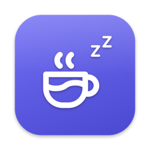
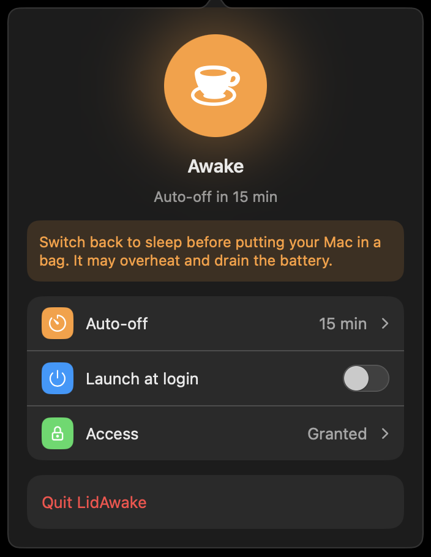

<div align="center">
  
  <h1>LidAwake</h1>
  <p><b>Keep your Mac awake with the lid closed — in one click.</b></p>

  
  
  
  <a href="LICENSE"></a>
</div>

<br>

<div align="center">
  
</div>

<br>

LidAwake is a tiny menu-bar utility. Click the icon and your Mac **keeps running with the lid closed** — so a
download, render, build, music, call, server or script carries on while the laptop is shut. Click again to go back to
normal sleep.

- **One click.** Left-click the menu-bar icon to switch; no windows, no Dock icon.
- **Honest.** The icon always shows the real system state, never what the app last clicked.
- **No password after setup.** A one-time permission, limited to exactly two commands (see [Security](#security)).
- **Auto-off timer.** Optionally switch Awake off by itself after 15 min – 8 h.
- **Works without an external monitor.**
- **No third-party code.** Only Swift, SwiftUI/AppKit and system commands.

## Install

There is no packaged release yet, so build it from source. You need the Xcode Command Line Tools
(`xcode-select --install`).

```bash
git clone https://github.com/kokush-v/lidawake.git
cd lidawake
make test      # optional: run the unit tests
make install   # build, sign (ad-hoc) and copy to /Applications
open /Applications/LidAwake.app
```

Requires macOS 13 (Ventura) or later.

## Use

| Menu-bar icon | Meaning |
|---|---|
| Coffee cup | **Awake** — the Mac will not sleep when the lid is closed |
| Zzz | **Sleep** — normal behavior |
| Lock | Access not granted yet (one-time setup needed) |
| Warning triangle | Access granted, but the sleep state cannot be read |

- **Left click** the icon: switch between Awake and Sleep immediately.
- **Ctrl+click** (or right click): open the panel. Click the large icon at the top to switch the mode, see a reminder
  while awake, set the *Auto-off* timer, toggle *Launch at login*, expand *Access* to see the rule in effect (and *Revoke access*), or *Quit*.
- Hover over the icon for a short description of the current state.

### One-time setup

On first launch the icon shows a lock. Click it: the panel explains the one-time permission. Press **Show command**
to see exactly what will be allowed, then **Grant access** and confirm with your administrator password in the
standard macOS dialog. After that, switching never asks for a password. **Revoke access** in the panel removes the
permission again.

## Security

LidAwake needs root to change the sleep setting, so it asks for **one narrow sudoers rule** instead of running as root.
The rule allows exactly two commands for your user, nothing else:

```
<you> ALL=(root) NOPASSWD: /usr/bin/pmset -a disablesleep 0, /usr/bin/pmset -a disablesleep 1
```

- `sudo` matches the full command line, so no other `pmset` argument and no other program is allowed.
- The rule is written to `/etc/sudoers.d/lidawake` by a short, reviewable script —
  [`grant-access.sh`](Resources/scripts/grant-access.sh) — and is checked with `visudo -cf` before it is activated.
  The whole sudoers configuration is validated again afterwards, and the rule is removed if anything is wrong.
- The app embeds the text of the grant/revoke scripts at build time and runs that text through the standard macOS
  administrator prompt; it never runs a script file from disk and never stores your password.
- Setup and revoke only happen when you press the button. You can inspect the rule any time:
  `sudo cat /etc/sudoers.d/lidawake`.

Anything running as your user can use that permission to turn the mode on or off — and nothing more.

## Important

- The mode turns off by itself only if you pick an *Auto-off* time (the default is *Off*), and only while LidAwake is
  running. Before you put the Mac in a bag, switch back to Sleep — otherwise it may overheat and drain the battery.
- After a restart the mode can still be on while LidAwake is not running, so there is no icon. Turn on
  **Launch at login** in the panel to always see the state.
- Quitting LidAwake does not change the mode; if Awake is on, the app asks for confirmation first.

## How it works

The mode is the system's `SleepDisabled` setting. Switching runs `sudo -n /usr/bin/pmset -a disablesleep 1|0`
(`-a` applies to all power sources, `-n` means "never ask for a password") and then re-reads the real state.

State comes only from the system: `pmset -g` (`SleepDisabled`) and `sudo -n -l` (is the rule in effect), refreshed
every 5 seconds so changes made elsewhere show up too. The icon is never based on what the app last clicked.

## FAQ

**Why not just `caffeinate`?**
`caffeinate` asks macOS not to sleep, but closing the lid overrides that request on a MacBook. Changing the
`disablesleep` power setting is what keeps the Mac running with the lid closed.

**Is `disablesleep` officially supported?**
It is not listed in `man pmset`, although it works and shows up as `SleepDisabled` in `pmset -g`. Apple could change
it in a future macOS release.

**Is it safe to leave on?**
A closed MacBook that never sleeps can get hot and run its battery down. Use it for a download or a build, then switch
back to Sleep before packing the laptop.

**Does it start on its own?**
Only if you turn on *Launch at login*. The mode itself is never switched on automatically; it switches off by itself only if you set an *Auto-off* time.

## Uninstall

Turn off *Launch at login* in the panel, then:

```bash
make uninstall   # removes the sudoers rule (asks for your password) and deletes the app
```

## Development

Swift Package with a testable core library (`LidAwakeCore`) and a thin AppKit/SwiftUI app (`LidAwake`).

```bash
make test      # unit tests (Swift Testing)
make build     # build/LidAwake.app
swift scripts/make-icons.swift Resources/Icons   # regenerate menu-bar and panel icons from the SVG sources
swift scripts/make-app-icon.swift Resources      # regenerate the app icon
```


## License

[MIT](LICENSE)
